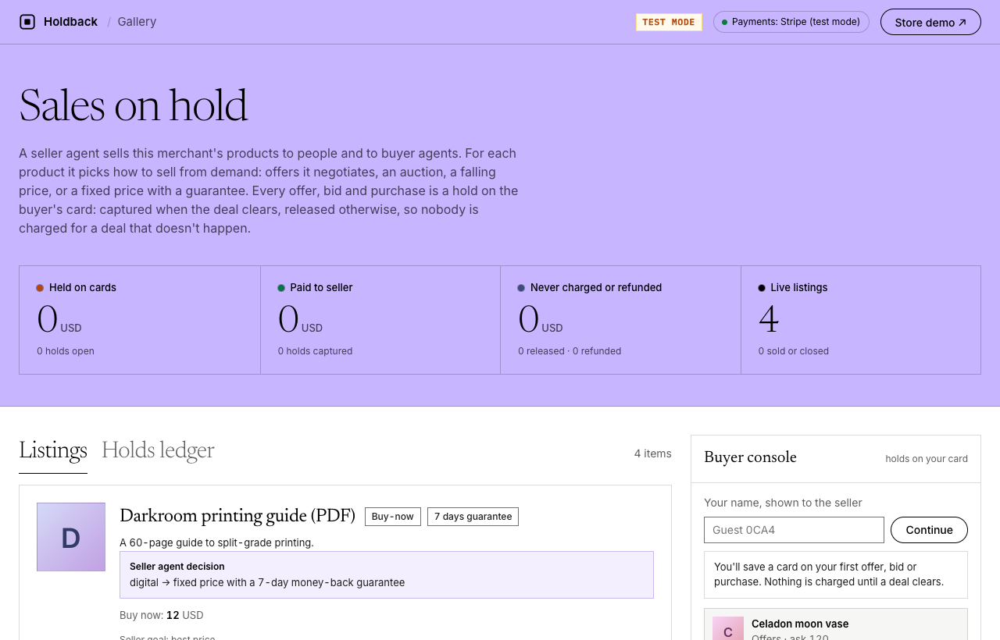
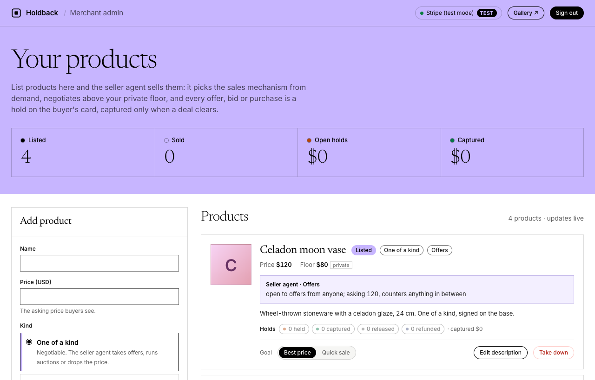
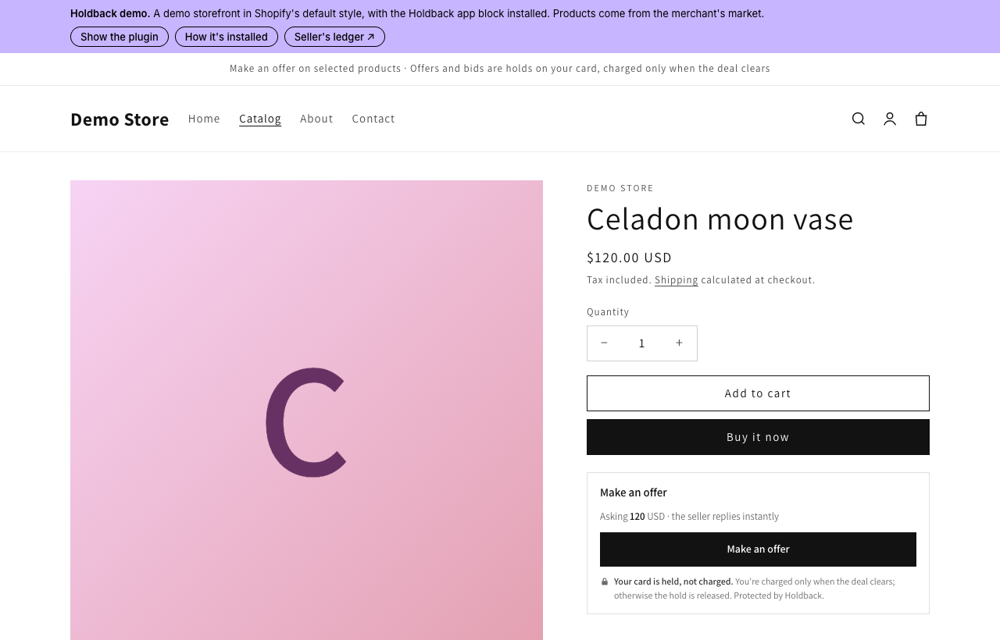

# Holdback

**Flexible pricing on ordinary card payments. Every offer, bid and purchase is a hold, captured only when the deal clears.**



> The crypto version (Solana program + EVM escrow, the Crypto World's Fair submission) is archived on the
> [`crypto`](../../tree/crypto) branch. `main` moves to card and other non-crypto payments; see
> [docs/v2-plan.md](docs/v2-plan.md).

Software and small shops mostly sell one way: a fixed price, take it or leave it. Real markets bargain, run
auctions, discount slow stock and offer money-back guarantees, and now AI agents can do that bargaining for
people. Card networks already have the primitive that makes it safe: **authorize now, capture later, capture
less than you authorized, or release it**. Holdback turns that primitive into sales mechanisms:

> Auctions, offers, discounts and guarantees are all the same thing: **rules about how much of a held payment to capture.**

| Mechanism | Hold | Capture | Back to the buyer |
|---|---|---|---|
| Make an offer / bargain | each offer | when the seller accepts | declined, withdrawn or replaced → released, never charged |
| Proxy auction (second price) | each bidder's max | winner pays 2nd max + 1 (partial capture) | the rest of the winner's hold, every losing bid |
| Dutch auction (price falls) | current price | immediately | — |
| Buy now + money-back guarantee | price | at purchase | refunded on request inside the window |

A **seller agent** picks the mechanism from demand (one watcher → offers, three → auction, none → Dutch) and
switches as demand changes. It negotiates against a private floor. **Buyer agents** bargain within their owner's
limit, which the server enforces on every hold. Merchants list products on an admin page. Humans join through
the web page or the store widget, and any MCP-capable agent (Claude Desktop, Claude Code) joins through the
`holdback-market` MCP server.

## What it looks like

**Merchant admin** (`/admin/`): add products with a price, a private floor, photos and a guarantee; watch the
seller agent's decisions and every hold live.



**In a store** (`/store/`): the widget sits under *Buy it now* on any product page (Shopify theme block included).
An offer places a hold on the buyer's card; nothing is charged until the deal clears.



## How the seller agent bargains

Rule-based and local (no LLM): accept at or above its standing price, decline below the private floor (the hold
is released), otherwise counter with a concession that grows each round. Best-price concedes 30%, 50%, 70%, 85%
of the gap; quick-sale 50%, 75%, 90%, 100%. The buyer's message nudges it within the floor: hardship concedes a
little more, enthusiasm a little less, rudeness costs the round. Asking 120, floor 80:

```
Buyer   offers 60, "Who made this?"
Seller  Good question: Celadon moon vase is a 1/1. Wheel-thrown stoneware with a celadon glaze, 24 cm.
        And your card is only authorized until we agree... 60 doesn't work, so your hold is released;
        the asking price is 120 USD.
Buyer   offers 85
Seller  Meeting you partway: 103 USD.
Buyer   offers 95, "I'm a student"
Seller  Fair enough about being a student, so I'll meet you a little more this time. My counter is 99 USD.
Buyer   accepts 99          → a 99 hold is placed and captured
```

Details: [`demo/market/negotiation.mts`](demo/market/negotiation.mts).

## How it fits together

```
 Merchant: /admin/ (products)     People: Gallery page, store widget     Agents: Claude via MCP
              │                                  │                                │
              └──────────────────────► Holdback market server ◄──────────────────┘
                          seller agent (mechanism choice) + negotiation engine
                                 │  every offer / bid / purchase = HOLD
                    ┌────────────┴─────────────┐
                    ▼                          ▼
     Stripe (PaymentIntents, manual capture)   SQLite (products, buyers, holds)
```

## Run it

Requirements: Node 22.18+ (runs `.mts` files directly), pnpm, and a Stripe account (test mode is enough).

```bash
pnpm install
cp .env.example .env              # add your Stripe test keys (dashboard.stripe.com/test/apikeys)
npm start                         # http://localhost:4022
```

1. Open `http://localhost:4022/admin/`, paste the admin token (printed at startup; stored in `data/admin-token`),
   and add products: price, a private floor for negotiable items, photos, guarantee days.
2. Open `/` (Gallery) or `/store/` as a buyer. The first offer, bid or purchase asks you to save a card with Stripe
   (test card `4242 4242 4242 4242`). Holds appear on the card as authorizations; only captured amounts are charged.
3. Connect Claude through the MCP server (`mcp/README.md`) to let an agent shop within a limit.

Tests: `npm test` (offline), `npm run test:stripe` and `npm run test:mcp` (Stripe test mode; skipped without keys).

## Add it to a store

The plugin is one script and one mount point. It renders in Shadow DOM, so the store's CSS can't break it,
and it fires `holdback:hold`, `holdback:purchase`, `holdback:release` (hold voided, never charged) and
`holdback:refund` (charged, then refunded) events for the store to react to.

```html
<script src="https://YOUR-MARKET/holdback.js" defer></script>
<div data-holdback-item="YOUR-PRODUCT-ID"></div>
```

On Shopify it ships as a theme app extension (`demo/public/store/extension/`): the merchant adds the
**Holdback offers & bids** block under Buy it now in the theme editor. Run `npm run shopify:assets` to copy the
widget into the extension before deploying it.

## Repository

| Path | What |
|---|---|
| `demo/mechanism.mts` | Seller agent: mechanism choice, offer response, second-price settlement, Dutch schedule |
| `demo/market/server.mts` | Market server: the HTTP API in `demo/API.md`, SSE, holds, auctions, buyer and admin auth |
| `demo/market/payments.mts` | `HoldProvider` interface and `StripeProvider` |
| `demo/market/db.mts` | SQLite persistence |
| `demo/market/negotiation.mts` | Negotiation engine: counters, buyer-message intents |
| `demo/public/` | Gallery (`/`), merchant admin (`/admin/`), card setup (`/card/`), widget (`holdback.js`), demo store + Shopify extension (`store/`) |
| `mcp/` | `holdback-market` MCP server for Claude and other agents |
| `docs/v2-plan.md` | Plan for card payments and real merchants |

## Status and next steps

- Done: Stripe holds (authorize, partial capture, void, refund), persisted products/buyers/holds, buyer and admin
  tokens, merchant admin page, card setup for people and agents.
- Next (see `docs/v2-plan.md`): Stripe webhooks, buyer accounts (email sign-in instead of browser tokens),
  Connect for multiple merchants, then a first live merchant (Auspice).

## License

MIT. See [LICENSE](LICENSE).
